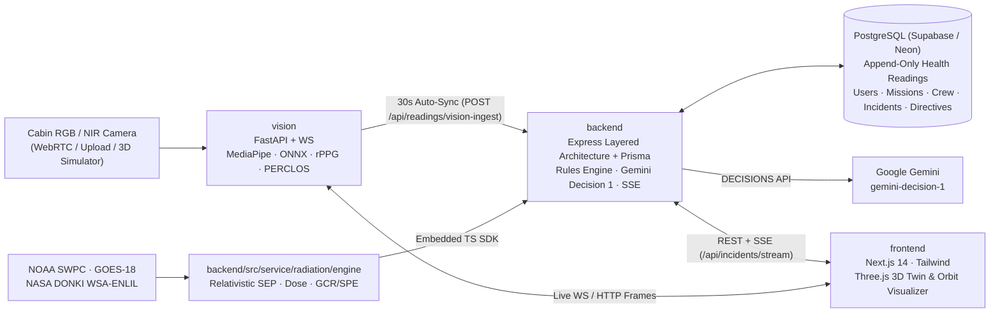

# Orbvital — Autonomous Deep-Space Crew Health, 3D Digital Twin & Space-Weather Triage

> **Event:** 2026 NASA Space Apps Challenge — *Create Health Monitoring Software for Astronauts on Space Missions*  
> **Repository:** [OlmosMyCity/NSA2026](https://github.com/OlmosMyCity/NSA2026)  
> **Domains:** Crew Medical Autonomy · Physiological Digital Twin · Relativistic Radiation Dosimetry · Contactless Vision Biometrics · Flight Surgeon Command

---

## Project Vision: Why Orbvital Exists

Human spaceflight is crossing a structural boundary. In Low Earth Orbit (ISS), astronauts operate inside Earth's protective magnetosphere with near-instantaneous voice/telemetry links (<2 s delay) and emergency return capability measured in hours. As missions expand to **Lunar orbits**, **Lunar South Pole habitats**, **Gateway NRHO**, and **interplanetary Mars transit**—carrying 20–40 minute two-way light-time delays, periodic solar conjunction blackouts, and sustained deep-space radiation—**Earth-tethered telemedicine cannot remain the sole loop for acute clinical decisions**.

**Orbvital** transforms raw physiological logs, contactless cabin camera feeds, live space-weather telemetry, and orbital mission dynamics into an **autonomous, explainable, closed-loop onboard medical intelligence platform**:

1. **Explainable Clinical Autonomy (*"Rules Decide, AI Advises"*):**  
   A deterministic clinical rules engine anchored in **NASA-STD-3001** and **NASA Human Research Program (HRP)** thresholds establishes the authoritative physiological status (`green` / `amber` / `red`), phase-adjusted vital norms, overdue telemetry windows, trend slopes, and emergency directives. **Gemini Decision 1 (`gemini-decision-1`)** runs solely on explicit triage demand to assist with recommended action selection (`re_measure`, `rest`, `exercise`, `shelter_shielding`, `contact_ground`, `no_action`), confidence scoring, and optional free-text mood / instrument photo estimation without allowing opaque model hallucinations to override clinical safety bounds.
2. **Proactive Environmental & Phase Coupling, Not Passive Charts:**  
   Astronaut vitals do not exist in a vacuum. Heart rate of 125 bpm during launch `+Gx/+Gz` acceleration or 48 bpm in 0-G orbital cruise can be physiologically expected, whereas mild hypoxia during an **S4 Solar Particle Event (SPE)** outside a Storm Shelter is an acute emergency. Orbvital correlates active mission phase (`phaseNorms.ts`), habitat environment (`SPACECRAFT`, `STATION`, `ROVER`, `LUNAR_BASE`, `MARS_BASE`), and real-time **NOAA SWPC / GOES / NASA DONKI** solar storm scales directly into cross-domain triage priorities (such as automatic `P0_STORM_CRITICAL` shelter-in-place protocols).
3. **Zero-Friction Capture, Immutable Medical Integrity & Instant Scenario Rehearsal:**  
   Crew members with high workload and low attention budget can log vitals through a 4-step intake wizard featuring a **3-question behavioral mood check-in** (`/readings/new`) or stream cabin video to **Orbvital Vision (`vision`)** for contactless **rPPG heart rate / HRV**, **NASA-standard PERCLOS fatigue**, and **affect/stress estimation**—with an animated **3D anatomical synthetic head (`SyntheticHead3D`)** and browser simulator fallback when running serverless demos. All persisted health records enforce **append-only clinical integrity** (no edits or deletes; invalidations and linked corrections only, guarded by PostgreSQL triggers). Inside the `/dashboard` **3D Digital Twin**, crew and Flight Surgeons can run instant zero-token **What-If scenario simulations** seeded from live crew vitals before committing an explicit AI triage call.

---

## Platform Pillars

### 1. Interactive 3D Physiological Digital Twin (`/dashboard`)
- **5-Zone Anatomical Twin:** Interactive 3D model (`Body3D` + right-hand zone inspector) covering **Heart** (resting HR, systolic/diastolic BP), **Brain** (mood, cognitive/affective load), **Blood** (blood glucose, SpO₂, body temperature), **Bones** (ARED/T2 resistive countermeasure adherence in altered gravity), and **Sleep** (daily sleep duration & overdue checks).
- **Phase-Adjusted Physiological Norms (`NASA-STD-3001 & HRP`):** Clinical evaluation adapts thresholds across four operational regimes (`phaseNorms.ts`):

| Flight Regime | Applicable Phases | Expected Nominal Adjustments (vs. 1-G Baseline) | Physiological Basis |
| :--- | :--- | :--- | :--- |
| **1-G Earth Baseline** | Pre-launch | HR `50–90 bpm`, SBP `90–129 mmHg`, DBP `<= 84 mmHg`, SpO₂ `>= 95%`, Sleep `>= 7.0 h` | Standard pre-flight clinical screening norms |
| **Launch & Ascent (`+Gx/+Gz`)** | `ascent`, `heo` | HR `60–135 bpm`, SBP `95–155 mmHg`, DBP `<= 95 mmHg`, SpO₂ `>= 94%` | Sympathetic surge & thoracic acceleration load |
| **Microgravity / Orbital Cruise (`0-G`)** | `parking`, `leo`, `outbound`, `transit`, `cruise`, `lunar_orbit`, `nrho`, `return`, `flyby`, `gravity_assist`, `perihelion` | HR `45–88 bpm`, SBP `85–125 mmHg`, Sleep `>= 6.5 h/day` | Cephalad fluid shift, baroreceptor unloading & circadian drift |
| **Entry, Descent & Landing** | `approach`, `descent`, `edl`, `landing` | HR `55–130 bpm`, SBP `85–145 mmHg`, SpO₂ `>= 94%` | Reentry `+Gx/+Gz` load & orthostatic intolerance |

- **NASA HRP 5-Hazard Exposure Model (`hazards.ts`):** Quantifies normalized per-zone environmental stress across **Space Radiation**, **Isolation & Confinement**, **Distance from Earth**, **Altered Gravity Fields**, and **Hostile Closed Environments** tailored by habitat and solar storm scale.
- **What-If Scenario Dock (`ScenarioDock`):** Real-time simulation across mission habitats, NOAA solar storm scales (`S0`–`S5`), shielding tiers, and physiological slider perturbations without spending LLM tokens.
- **Gemini Decision 1 Clinical Triage (`decisionService.ts`):** Server-side evaluation using `@google/genai` with deterministic caching, offline fallback (`DEMO_OFFLINE`), quota guard (`DECISION_API_MAX_CALLS`), and multimodal free-text mood & instrument photo estimation.

### 2. Deep Space Radiation Early Warning & Dosimetry Engine (`backend/src/service/radiation/engine`)
- **Live Heliophysics Ingestion:** Streams operational 1/2/3-day solar flare & SPE probabilities from **NOAA SWPC**, 1-minute GOES X-ray (`0.1–0.8 nm`) and $>10\text{ MeV}$ proton telemetry, DSCOVR/ACE solar wind plasma & IMF $B_z$, and **NASA DONKI WSA-ENLIL** CME shock analyses with offline fallback resilience.
- **Relativistic Parker Spiral Early Warning (`sepPrediction.ts`):** Tracks GOES X-ray flux rise rate ($dF/dt$) to catch X-class / steep M-class flare onsets and computes proton transit times along the curved Parker Spiral ($1.25\text{ AU}$ with pitch-angle scattering) via:
  $$v(E) = c \sqrt{1 - \left(\frac{m_p c^2}{E + m_p c^2}\right)^2}$$
  producing an actionable **~20–90 minute warning lead window** prior to peak Solar Particle Event impact in cislunar/lunar space.
- **Shielding-Attenuated Biological Dosimetry (`doseCalculator.ts`):** Models effective dose rates ($\mu\text{Sv/h}$) and 30-day projections ($\text{mSv}$) against **NASA-STD-3001** caps ($250\text{ mSv}$ 30-day / $500\text{ mSv}$ career reference) across:
  - `EVA_SUIT` ($1.2\text{ g/cm}^2$, $95\%$ proton transmission)
  - `CREW_CABIN_NOMINAL` ($10.0\text{ g/cm}^2$, $25\%$ transmission)
  - `STORM_SHELTER` ($25.0\text{ g/cm}^2$, $4\%$ transmission / $96\%$ attenuation)
- **Interactive Storm Simulator:** Supports `NOMINAL`, `FLARE_EARLY_WARNING` (X4.5 trigger with 48 min countdown), `PEAK_STORM_S4`, `SIDE_MISS_CME`, and parametric custom CME events (`POST /api/radiation/predict-impact`).

### 3. Contactless AI Computer Vision Biometrics (`vision` & `/vision`)
- **CPU-First, Open-Source Stack:** Runs on standard CPU (`FastAPI` + `WebSockets` + `MediaPipe Face Landmarker` 478 landmarks + `ONNX Runtime FERPlus` + `SciPy`) without GPU bloat.
- **Multi-Camera rPPG (`rppg_engine.py`):** Extracts Blood Volume Pulse from forehead (glabella) and cheek ROIs using **POS** (*Plane-Orthogonal-to-Skin*) and **CHROM** for RGB cameras plus single-channel spatial-temporal **NIR-rPPG** for low-light/sleep-pod infrared feeds—delivering BPM, HRV (`RMSSD`, `SDNN`), respiration rate (RPM), PSD spectrum, and Signal Quality Index (SQI).
- **Fatigue & Sleep-Pod Actigraphy (`sleep_engine.py`):** Computes **EAR** (*Eye Aspect Ratio*), NASA-standard **PERCLOS**, **MAR** (*Mouth Aspect Ratio* yawn counter), 3D head-pose pitch/yaw/roll nodding, microsleep events, and frame-difference actigraphy for sleep staging (`Deep Rest`, `Light/Restless Sleep`, `Awake`).
- **Mood, Stress & 3D Synthetic Fallback (`mood_engine.py`, `SyntheticHead3D.tsx`, `visionMock.ts`):** Fuses `emotion-ferplus-8.onnx` probabilities with geometric facial Action Units into stress index ($0\text{–}100$), valence ($-1\text{ to }+1$), and cognitive alertness. In browser-only/serverless demos where `:8000` is offline, `/vision` renders a live 3D anatomical head animated by real-time respiration, pulse, head pose, and stress color modulation alongside browser mock telemetry—and swaps automatically to live `vision` when available.
- **Automated Clinical Sync:** `/vision` batches live biometric frames every **30 seconds** into `POST /api/readings/vision-ingest`, deriving NASA HRP mood ($1\text{–}5$) and sleep-equivalent hours alongside persisted vitals.

### 4. 3D Multi-Mission Trajectory & Live Moment Visualizer (`/visualizer`)
- Interactive orbital and interplanetary mission viewer featuring real crewed NASA profiles—**Artemis II (Cislunar Free-Return)**, **ISS Expedition 72 (LEO)**, **Apollo 8**, **Apollo 11**, **Apollo 13**, and **Apollo 17**—alongside configurable trajectories (`LRO`, `Mars 2020`, `Europa Clipper`, `Parker Solar Probe`), custom trajectory JSON uploads, and launch vehicle switching.
- Synchronizes elapsed mission clock ticks with spacecraft position, heliocentric/cislunar coordinates, mission phases, and phase-specific physiological hazard emphasis.

### 5. Flight Surgeon Console, Append-Only Integrity & Autonomous Incident SLA (`/admin`, `/routine`)
- **Append-Only Medical Record Integrity (`P1–P7`, see [REGLAS_DE_NEGOCIO.md](./docs/REGLAS_DE_NEGOCIO.md)):** Health readings are strictly immutable once logged. Erroneous readings are formally **invalidated with an audit reason** (`POST /api/readings/:id/invalidate`) or superseded transactionally via linked corrections (`POST /api/readings/:id/corrections`), enforced by PostgreSQL trigger `health_readings_append_only` and Prisma Migrate (`20261115000000_immutable_health_data`). `PUT/PATCH/DELETE /api/readings/:id` return `405 Method Not Allowed`.
- **Automated Incident Detection & Correlation (`syncSystemIncidents.ts`, `correlation.ts`):** Every abnormal reading or `S1`–`S5` solar storm opens/deduplicates database-backed `Incident` records; during `S3+` storms, `CRITICAL` medical cases automatically escalate to `P0_STORM_CRITICAL` shelter-in-place directives.
- **Real-Time SSE Stream (`GET /api/incidents/stream`):** Broadcasts `incident:opened`, `incident:escalated`, `incident:acknowledged`, and `incident:closed` events via `IncidentNotificationCenter` with SLA acknowledgement timers (`5 min` Critical / `15 min` Warning).

---

## System Architecture



### Project Structure (Layered Architecture)

```text
NSA2026/
├── backend/                         # Express 4 + TypeScript REST API & Clinical Decision Core
│   ├── prisma/                      # PostgreSQL schema, Prisma Migrate migrations & idempotent seed/seed.sql
│   ├── src/
│   │   ├── config/                  # Prisma client singleton, multipart image-upload configuration
│   │   ├── controller/              # Express controllers (HTTP in/out)
│   │   │   └── routes/              # Express routers: endpoint mapping + middleware chain per resource
│   │   ├── dto/                     # Zod request schemas (input contracts)
│   │   ├── entity/                  # Domain entities & DTO types (Astronaut, Mission, HealthReading, Incident, Directive, User)
│   │   ├── exception/               # AppError hierarchy + global error handler
│   │   ├── repository/              # Repository contracts (I*Repository) + Prisma implementations
│   │   ├── security/                # JWT auth, role guard, rate limiter, security headers, bcrypt, token service
│   │   ├── service/                 # Business logic grouped by domain
│   │   │   ├── astronaut/  auth/  mission/  incident/  health/  admin/  operator/  storage/
│   │   │   └── radiation/engine/    # Space-weather physics engine (NOAA/NASA clients, SEP, dose, simulator)
│   │   ├── app.ts                   # Express application factory
│   │   └── index.ts                 # HTTP entrypoint
│   └── tests/unit/                  # Vitest suites (unit & HTTP integration tests, incl. radiation engine)
├── frontend/                        # Next.js 14 App Router + React 18 + Three.js UI
│   ├── public/                      # 3D anatomical assets (/anatomy/body.glb, head.glb) & trajectory JSONs
│   └── src/
│       ├── app/                     # Pages / routes: /dashboard, /visualizer, /vision, /trends, /routine, /missions, /astronauts, /admin, /operator
│       ├── components/<feature>/    # Presentation layer (UI components grouped by feature)
│       ├── hooks/                   # React state hooks
│       ├── context/                 # React context providers (AuthContext)
│       ├── services/                # API clients & HTTP access layer
│       ├── domain/<feature>/        # Pure types & client-side evaluation logic
│       ├── config/                  # Environment configuration
│       └── mocks/                   # Offline/demo data
├── vision/                          # Python 3.11 FastAPI contactless biometric service (rPPG, PERCLOS, Mood/Stress)
│   ├── src/                         # api/ · engines/ · vision/ · schemas.py · config.py · pipeline.py
│   └── tests/                       # Pytest suites for rPPG, sleep, mood & API
├── docs/                            # Challenge alignment, deployment architecture, integrity rules, radiation specs & wireframes
├── AI_DECLARATION/                  # AI usage declaration required by NASA Space Apps
└── vercel.json                      # Unified Vercel Services deployment routing (/api/* & /health -> backend, /* -> frontend)
```

Request flow (backend): `controller/routes` → `security` → `controller` → `service` → `repository` → PostgreSQL.

---

## Core API Surface (`backend`)

All primary API routes are mounted under `/api/*` (with health checks at `/health` and `/api/health`):

| Domain | Endpoints | Auth / Role | Purpose |
| :--- | :--- | :--- | :--- |
| **Auth** | `POST /api/auth/register`, `POST /api/auth/login`, `GET /api/auth/me` | Public / JWT | Registration, bcrypt authentication, current user session |
| **Missions** | `GET /api/missions`, `GET /api/missions/:id`, `POST/PUT/DELETE /api/missions` | Public read / `ADMIN` write | Crewed & planetary mission registry & patch upload |
| **Crew & Digital Twin** | `GET /api/astronauts`, `GET /api/astronauts/:id`, `GET /api/astronauts/:id/summary`, `GET /api/astronauts/:id/digital-twin`, `POST /api/astronauts/:id/simulate`, `POST /api/astronauts/digital-twin/evaluate` | JWT (`ADMIN` for crew CRUD) | Crew profiles, 5-zone physiological twin evaluation, What-If simulation, Gemini Decision 1 triage |
| **Append-Only Readings & Vision** | `GET/POST /api/readings`, `GET /api/readings/:id`, `POST /api/readings/:id/invalidate`, `POST /api/readings/:id/corrections`, `POST /api/readings/vision-ingest` (`PUT/PATCH/DELETE` -> `405`) | JWT | Append-only 7-vital clinical logs, audit invalidations/corrections, automatic incident triggers & Vision sync |
| **Space Radiation** | `GET /api/radiation/status`, `GET /api/radiation/cme-forecast`, `POST /api/radiation/simulate`, `POST /api/radiation/predict-impact` | Public read / `ADMIN` simulate | Live NOAA/NASA status, proton ETA countdown, dose attenuation, simulation & custom CME impact |
| **Incidents & Protocols** | `GET /api/incidents`, `GET /api/incidents/stream`, `GET /api/incidents/protocols`, `GET /api/incidents/mission-catalog`, `GET /api/incidents/:id`, `POST /api/incidents`, `PATCH /api/incidents/:id/acknowledge`, `PATCH /api/incidents/:id/close` | JWT (`ADMIN` open/close) | Database-backed incident lifecycle, SSE real-time push, SLA escalation & NASA HRP protocols |
| **Flight Surgeon** | `GET /api/admin/triage`, `GET /api/admin/astronauts/:id/directives`, `POST /api/admin/astronauts/:id/directives` | `ADMIN` | Multi-astronaut triage matrix correlated with active storm scale & clinical directives |
| **Media Uploads** | `POST /api/uploads/astronauts`, `POST /api/uploads/missions` | `ADMIN` | Multipart image upload via Vercel Blob or Supabase Storage |

---

## Local Development Quickstart

### Prerequisites
- **Node.js 22+** & **npm 10+**
- **PostgreSQL** instance (e.g., Supabase or Neon free tier)
- **Python 3.11+** (optional, required only for running native `vision`)

### 1. Install Dependencies
```bash
cd backend && npm install
cd ../frontend && npm install
```

### 2. Configure Environment Variables
Copy the provided templates and populate your credentials:
- `backend/.env` (from `backend/.env.example`):
  - `DATABASE_URL` / `DIRECT_URL`: PostgreSQL pooled & direct connection strings
  - `JWT_SECRET`: Signing secret for bearer tokens (required in runtime)
  - `GEMINI_API_KEY`: Optional server-side key for `gemini-decision-1` (set `DEMO_OFFLINE="true"` to run 100% deterministically without API calls)
  - `ALLOWED_ORIGINS`: Comma-separated allowed CORS origins (`http://localhost:3000,...`)
  - `BLOB_READ_WRITE_TOKEN` or `SUPABASE_URL` + `SUPABASE_SERVICE_ROLE_KEY`: Image upload storage
- `frontend/.env.local` (from `frontend/.env.example`):
  - `NEXT_PUBLIC_API_HOST=http://localhost:4000/api`
  - `NEXT_PUBLIC_API_URL=http://localhost:4000`
  - `NEXT_PUBLIC_VISION_URL=http://localhost:8000`
  - `NEXT_PUBLIC_USE_MOCKS=false`

### 3. Apply Migrations, Seed & Run Services
```bash
# Terminal 1 — Backend API (port 4000)
cd backend
npx prisma generate
npm run prisma:deploy
npx prisma db seed
npm run dev

# Terminal 2 — Next.js Frontend (port 3000)
cd frontend
npm install
npm run dev

# Terminal 3 — Optional AI Vision Biometrics Server (port 8000)
cd vision
python3.11 -m venv .venv
.venv/bin/pip install -r requirements.txt
.venv/bin/python download_models.py
.venv/bin/python run.py --port 8000
```

Open `http://localhost:3000` in your browser.

### 4. Demo & Judge Test Credentials

Seeded automatically by `npx prisma db seed` (and `prisma/seed.sql`), as well as in offline/serverless mock mode (`NEXT_PUBLIC_USE_MOCKS=true`):

| Role | Email | Password | Access & Capabilities |
| :--- | :--- | :--- | :--- |
| **ADMIN (Flight Surgeon)** | `elena.rodriguez@nasa.gov` | `HrpFlight#2026` | Full command access (`/admin`), multi-crew triage, clinical directives, incident acknowledgement/closure, radiation storm simulation, and mission/crew CRUD |
| **USER (Crew / Astronaut)** | `r.wiseman@nasa.gov` | `OrionCrew#4IV` | Crew dashboard (`/dashboard` — 3D Digital Twin & What-If simulator), vital intake (`/readings/new`), daily routine (`/routine`), contactless Vision (`/vision`), and 3D mission visualizer (`/visualizer`) |
| **OPERATOR (Ground Ops)** | `m.chen@nasa.gov` | `GroundOps#2026` | Ground supervision console (`/operator`), read-only telemetry & crew location monitoring for assigned missions (`Apollo 11` / `mission-01` by default) |

---

## Automated Testing & Verification

| Component | Command | Coverage |
| :--- | :--- | :--- |
| **Backend API & Clinical Core** | `cd backend && npx tsc --noEmit && npm test` | Digital Twin rules, Decision Service fallback, radiation engine physics, append-only health integrity, auth, uploads, incidents & triage correlation |
| **Frontend Typecheck & Build** | `cd frontend && npx tsc --noEmit && npm run build` | Next.js App Router, Three.js scenes, phase-adjusted evaluator, feature modules & API clients |
| **AI Vision Biometrics** | `cd vision && .venv/bin/pytest -v` | rPPG heart rate extraction, EAR/PERCLOS fatigue & actigraphy, Mood engine & FastAPI/WebSocket endpoints |

---

## 🤖 AI Usage Declaration

AI tools were used to build this project, and the product itself uses AI models (Gemini decision layer, FER+ and MediaPipe for contactless vitals). As required by NASA Space Apps, where and how AI was used is declared in [`AI_DECLARATION/`](AI_DECLARATION/README.md), with machine-readable metadata in [`ai-usage.json`](AI_DECLARATION/ai-usage.json). AI-assisted commits are marked with a `Co-Authored-By: Claude …` trailer.

---

## References & Standards

- **NASA-STD-3001, Volume 1 (Crew Health):** *NASA Spaceflight Human-System Standard — Pre-flight, In-flight, and Post-flight Physiological & Medical Standards* (<https://www.nasa.gov/ochmo/human-system-standards/>)
- **NASA-STD-3001, Volume 2 (Human Factors, Habitability, and Environmental Health):** *Translational Acceleration Limits, Launch/Entry/Landing (LEL) Tolerances, and Cabin Atmosphere* (<https://www.nasa.gov/ochmo/human-system-standards/>)
- **NASA Human Research Program (HRP):** *5 Hazards of Human Spaceflight & The Human Body in Space* (<https://www.nasa.gov/hrp/hazards>, <https://www.nasa.gov/hrp/bodyinspace>)
- **NOAA SWPC:** *Space Weather Scales for Solar Radiation Storms (S-Scale)* (<https://www.swpc.noaa.gov/noaa-scales-explanation>)
- **NASA DONKI:** *Space Weather Database Of Notifications, Knowledge, Information* (<https://kauai.ccmc.gsfc.nasa.gov/DONKI/>)
- **JPL Solar System Dynamics:** *Approximate Positions of the Planets & Crewed Mission Ephemerides (Apollo 8/11/13/17, ISS, Artemis II)* (<https://ssd.jpl.nasa.gov/>)

---

## Module Documentation Index

- [Backend API Documentation](./backend/README.md)
- [Frontend Web Platform Documentation](./frontend/README.md)
- [Deep Space Radiation Engine Package](./backend/src/service/radiation/engine/README.md)
- [AI Contactless Vision Biometrics](./vision/README.md)
- [Health Data Integrity & Business Rules (P1–P8)](./docs/REGLAS_DE_NEGOCIO.md)
- [Architecture & Free-Tier Deployment Guide](./docs/ARCHITECTURE_AND_DEPLOY_GUIDE.md)
- [NASA Space Apps 2026 Challenge Mapping](./docs/NASA_SPACE_APPS_CHALLENGE.md)
- [Radiation Engine Integration Guide](./docs/RADIATION_ENGINE_INTEGRATION_GUIDE.md)
- [Space Radiation Module Scientific Plan](./docs/SPACE_RADIATION_MODULE_PLAN.md)
