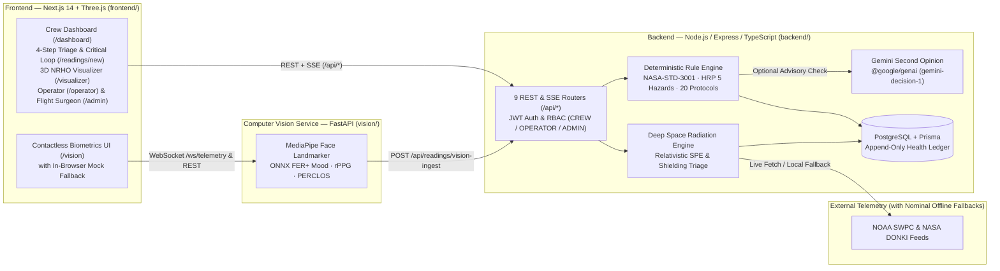

# OrbVital — Autonomous Deep-Space Crew Health, Vision Biometrics & Radiation Triage

**Team OlmosCity · 2026 NASA Space Apps Challenge**  
Challenge: *Create Health Monitoring Software for Astronauts on Space Missions*

- **Live Application:** [https://orbvital.health](https://orbvital.health)
- **Project Demonstration:** [https://canva.link/e446em42iebvr0o](https://canva.link/e446em42iebvr0o)
- **AI Transparency Declaration:** [`AI_DECLARATION/README.md`](./AI_DECLARATION/README.md)

---

## Summary

**Orbvital** is an autonomous crew health monitoring, contactless vision biometrics, and radiation triage platform built for astronauts and non-medical crewmates on deep-space missions, where Earth communication delays reach 23 minutes one-way and solar conjunctions cause 2 to 3 week blackouts.

Instead of replacing Earth flight surgeons or relying on unverified generative AI, Orbvital follows one core principle:

> **"Rules decide, AI advises."**

A deterministic decision engine grounded in **NASA-STD-3001** and the **NASA HRP 5 spaceflight hazards** evaluates **7 physiological vitals** across **4 flight phases** (`1-G`, `Ascent`, `0-G`, `EDL`) and **5 habitats** (`SPACECRAFT`, `STATION`, `ROVER`, `LUNAR_BASE`, `MARS_BASE`), while **Gemini** (`@google/genai`, `gemini-decision-1`) provides a plain-language second opinion. Using **MediaPipe** and **FER+ ONNX** computer vision, Orbvital identifies crew members without physical contact, detects incapacitation, and enables **Buddy Input Mode** for rapid crew-assisted triage. Results are visualized on an interactive **5-zone 3D Digital Twin** with a **What-If Dock** to simulate shielding and countermeasures risk-free. Integrated with live **NOAA SWPC** solar storm scales and **NASA DONKI** CME forecasts, Orbvital delivers early radiation triage alerts so crews can act autonomously when Earth cannot respond.

---

## Four Integrated Layers

1. **Contactless Vision Biometrics & Buddy Triage** ([`vision/README.md`](./vision/README.md) · [`/vision`](./frontend/src/app/vision/page.tsx))
   - FastAPI + OpenCV + MediaPipe Face Landmarker + ONNX Runtime (`emotion-ferplus-8.onnx`) extracts contactless rPPG heart rate, PERCLOS fatigue/sleep metrics, emotional state, and crew biometric embeddings from a standard RGB webcam (with synthetic/mock fallbacks for offline testing).
   - **Buddy Input Mode** and step-by-step intake ([`ReadingFormWizard.tsx`](./frontend/src/components/health/ReadingFormWizard.tsx)) let non-medical crewmates log vitals and symptoms rapidly during incapacitation or emergencies.

2. **Interactive 3D Digital Twin & 5-Habitat Calibration** ([`/dashboard`](./frontend/src/app/dashboard/page.tsx) · [`/visualizer`](./frontend/src/app/visualizer/page.tsx))
   - Three.js / React Three Fiber 3D anatomical twin maps **7 vitals** (`heartRate`, `bloodPressure`, `glucose`, `temperature`, `spO2`, `sleepHours`, `mood`) into **5 anatomical zones** (`Heart`, `Brain & Mood`, `Blood & Respiration`, `Bones & Muscles`, `Sleep`) calibrated across `SPACECRAFT`, `STATION`, `ROVER`, `LUNAR_BASE`, and `MARS_BASE`.
   - Includes a **What-If Dock** (`ScenarioDock.tsx`, `WhatIfPanel.tsx`) for risk-free simulation of solar storms, shielding, and countermeasures, plus a 3D NRHO Orbit & Mission Health Timeline (`/visualizer`).

3. **Mission-Aware Trajectory & Space-Weather Radiation Triage** ([`docs/RADIATION_ENGINE.md`](./docs/RADIATION_ENGINE.md))
   - In-process TypeScript heliophysics engine (`backend/src/service/radiation/engine`) ingests live **NOAA SWPC** solar radiation storm scales (`S0–S5`) and **NASA DONKI** CME / WSA-ENLIL forecasts (with local nominal fallbacks when offline) to compute lead times and triage bands (`EVA` hold vs. mandatory `STORM_SHELTER` ingress and increased vital monitoring cadence).
   - Live incident notifications stream to Crew, Ground Operators, and Flight Surgeons via Server-Sent Events (`GET /api/incidents/stream`).

4. **"Rules Decide, AI Advises" Triage, Guided Protocols & 15-Min Follow-Up Loop** ([`frontend/README.md`](./frontend/README.md) · [`backend/README.md`](./backend/README.md))
   - **Deterministic Clinical Authority**: 20 standardized clinical protocols (`PROTO_NOMINAL` + 19 caution/critical protocols in `medicalProtocols.ts`) generate actionable checklists paired with emergency bypasses when time-critical intervention is required.
   - **Bounded Critical Verification Loop**: `CRITICAL` assessments require protocol checklist acknowledgement and at most **1 confirmatory vitals re-check** (or an explicit emergency bypass) before escalation.
   - **15-Minute Warning Follow-Up Reminder**: `WARNING` submissions arm a persistent **Follow-Up Sticky Note** (`FollowUpStickyNote.tsx`) calibrated to the `15`-minute freshness window (`FRESHNESS_WINDOW_MIN` / `NEXT_PUBLIC_FRESHNESS_WINDOW_MIN`), clearing automatically once a nominal/resolved reading is logged.
   - **Advisory Gemini Layer**: `@google/genai` (`gemini-decision-1`) explains clinical context and discrepancies in plain language with offline `rules-fallback` (`DEMO_OFFLINE=true`).

---

## System Architecture



---

## Repository Structure

```text
NSA2026/
├── frontend/             # Next.js 14 App Router, 3D Digital Twin, Guided Triage UI & /visualizer
├── backend/              # Express + Prisma + PostgreSQL REST/SSE API, Deterministic Engine & Radiation Engine
├── vision/               # FastAPI + MediaPipe + ONNX FER+ Contactless Biometrics microservice
├── packages/             # Shared workspace package (`radiation-engine`)
├── apps/                 # Workspace deployment layout wrappers (`frontend`, `backend`)
├── docs/                 # Technical specifications, Radiation Engine docs, Business Rules & Wireframes
├── AI_DECLARATION/       # NASA Space Apps 2026 AI & Media Transparency Declaration (`README.md`, `ai-usage.json`)
└── vercel.json           # Multi-service Vercel routing (/api/* -> backend, /* -> frontend)
```

---

## API Surface (`/api`)

| Domain | Endpoints |
| :--- | :--- |
| **Auth** | `POST /api/auth/register`, `POST /api/auth/login`, `GET /api/auth/me` |
| **Missions** | `GET /api/missions`, `GET /api/missions/:id`, `POST /api/missions`, `PUT /api/missions/:id`, `DELETE /api/missions/:id` |
| **Astronauts, Location & Biometrics** | `GET /api/astronauts`, `GET /api/astronauts/biometrics/gallery`, `POST /api/astronauts/digital-twin/evaluate`, `GET /api/astronauts/:id/digital-twin`, `POST /api/astronauts/:id/simulate`, `GET/PATCH /api/astronauts/:id/location`, `GET/POST /api/astronauts/:id/biometrics`, `DELETE /api/astronauts/:id/biometrics/:sampleId`, `GET/POST/PUT/DELETE /api/astronauts/:id` |
| **Health Readings (Append-Only)** | `GET /api/readings`, `POST /api/readings`, `GET /api/readings/:id`, `POST /api/readings/vision-ingest`, `POST /api/readings/:id/invalidate`, `POST /api/readings/:id/corrections`, `GET /api/astronauts/:id/summary` |
| **Space Weather & Radiation** | `GET /api/radiation/status`, `GET /api/radiation/cme-forecast`, `POST /api/radiation/simulate`, `POST /api/radiation/predict-impact` |
| **Incidents & Protocols (SSE)** | `GET /api/incidents`, `GET /api/incidents/stream`, `GET /api/incidents/protocols`, `GET /api/incidents/mission-catalog`, `GET /api/incidents/:id`, `POST /api/incidents`, `PATCH /api/incidents/:id/acknowledge`, `PATCH /api/incidents/:id/close` |
| **Ground Operator Supervision** | `GET /api/operator/crew`, `GET /api/operator/crew/:astronautId` |
| **Flight Surgeon / Admin** | `GET /api/admin/triage`, `GET/POST /api/admin/astronauts/:id/directives`, `GET /api/admin/operators`, `POST /api/admin/users`, `PUT /api/admin/missions/:id/operator` |
| **Media Uploads** | `POST /api/uploads/astronauts`, `POST /api/uploads/missions` |

---

## Quickstart (Local Development)

### 1. Backend (`http://localhost:4000`)

```bash
cd backend
cp .env.example .env
npm install
npx prisma generate
npx prisma migrate deploy
npm run prisma:seed
npm run dev
```

### 2. Frontend (`http://localhost:3000`)

```bash
cd frontend
cp .env.example .env.local
npm install
npm run dev
```

> **Frontend-Only Mock Mode:** Set `NEXT_PUBLIC_USE_MOCKS=true` in `frontend/.env.local` to explore the full UI (auth, Digital Twin, guided reading triage, Crew/Operator/Surgeon consoles, and simulated Vision stream) using `frontend/src/mocks/` without a database or Python runtime.

### 3. Contactless Vision Microservice (`http://localhost:8000`, Optional)

```bash
cd vision
python -m venv .venv
source .venv/bin/activate
pip install -r requirements.txt
python download_models.py
python run.py
```

---

## Intended Impact & Dual-Use Value

- **Medical Autonomy Beyond LEO**: Closes the critical care gap when Mission Control flight surgeons cannot respond in real time due to 23-minute latency or 2–3 week solar conjunction blackouts.
- **Zero-Friction Crew Workflows**: Contactless vision + guided Buddy Input checklists reduce cognitive load and manual logging burden during incapacitation or acute radiation events.
- **Certifiable Safety by Design**: Separating deterministic NASA-backed rules (`HEALTH_BANDS`, 20 protocols, append-only ledger) from generative AI prevents hallucinations from driving life-critical decisions while maintaining full Earth sync auditability.
- **Dual-Use Terrestrial Impact**: Beyond Artemis/Mars crews and commercial habitats, the same offline-first triage architecture applies to submarines, Antarctic research stations, offshore rigs, mining sites, and remote rural clinics without continuous connectivity.

---

## NASA Data & Telemetry References

- [NASA Technical Standards System (NASA-STD-3001)](https://standards.nasa.gov/)
- [NASA HRP — 5 Hazards of Human Spaceflight](https://www.nasa.gov/hrp/hazards/)
- [NASA HRP — Risks of Human Spaceflight](https://www.nasa.gov/hrp/risks/)
- [NASA HRP — The Human Body in Space](https://www.nasa.gov/hrp/bodyinspace)
- [NASA HRP — Ongoing HRP Research in Space](https://www.nasa.gov/hrp/ongoing-hrp-research/)
- [NASA DONKI — Space Weather Database (CCMC)](https://ccmc.gsfc.nasa.gov/tools/DONKI/)
- [NASA DONKI API — CME Analysis](https://api.nasa.gov/DONKI/CMEAnalysis/)
- [NASA JPL — Solar System Dynamics (Ephemerides)](https://ssd.jpl.nasa.gov/)
- [NASA SVS — CGI Moon Kit (LRO/LROC 4K Texture)](https://svs.gsfc.nasa.gov/4720)
- [NASA PDS — GRAIL Lunar Gravity Data](https://pds-geosciences.wustl.edu/grail/grail-l-lgrs-5-rdr-v1/grail_1001/shadr/)

---

## Module & Technical Documentation Index

| Document | Scope |
| :--- | :--- |
| [Frontend README](./frontend/README.md) | Next.js 14 routes, 3D Digital Twin, guided protocol wizard, 15-min Follow-Up Sticky Note & env vars |
| [Backend README](./backend/README.md) | Layered architecture, deterministic engine, Gemini second opinion, API endpoints & Prisma schema |
| [Vision README](./vision/README.md) | FastAPI contactless biometrics pipeline (`MediaPipe`, `ONNX FER+`, `rPPG`, `PERCLOS`) & endpoints |
| [Architecture & Deploy Guide](./docs/ARCHITECTURE_AND_DEPLOY_GUIDE.md) | Technical inventory, zero-cost deployment blueprint (Vercel + Render) |
| [NASA Space Apps Mapping](./docs/NASA_SPACE_APPS_CHALLENGE.md) | Official 2026 challenge requirements mapped to Orbvital |
| [Deep Space Radiation Engine](./docs/RADIATION_ENGINE.md) | Heliophysics physics, relativistic SPE lead time & dose calculations |
| [Radiation Engine Integration Guide](./docs/RADIATION_ENGINE_INTEGRATION_GUIDE.md) | Connecting NOAA SWPC & NASA DONKI feeds into backend and frontend |
| [Radiation Module Plan](./docs/SPACE_RADIATION_MODULE_PLAN.md) | Technical specification for early warning & mitigation workflows |
| [Health Data Business Rules](./docs/REGLAS_DE_NEGOCIO.md) | Clinical & append-only database integrity rules (`P1–P8`) |
| [Ground Supervision & Freshness](./docs/SUPERVISION_TIERRA_Y_VIGENCIA_DATOS.md) | Ground Operator role design & 15-minute vital freshness rules |
| [Wireframes](./docs/wireframes/README.md) | Low-fidelity layout specs for frontend views |
| [AI Usage Declaration](./AI_DECLARATION/README.md) | Runtime AI & development assistance disclosure ([`ai-usage.json`](./AI_DECLARATION/ai-usage.json)) |
